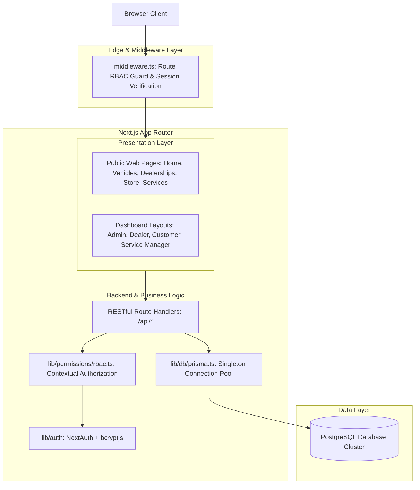

# CarCraft: Architecture Documentation

## 1. Architectural Philosophy
CarCraft is engineered as a **Modular Monolith** using **Next.js App Router** with TypeScript strict mode, Tailwind CSS, Shadcn-style components, and Prisma ORM backed by PostgreSQL.

The system avoids unnecessary microservice complexity while maintaining strict domain separation:
1. **Public Marketplace Domain**: Browsing, vehicle search, comparison, and dealer profiles.
2. **Inventory Management Domain**: Dealership-scoped vehicle CRUD, image galleries, and lead management.
3. **E-Commerce Domain**: Cart persistence, multi-channel simulated checkout, atomic stock reduction, and order lifecycle.
4. **Service Bay Scheduling Domain**: Real-time bay reservation, collision prevention, and service status dispatch.
5. **Role-Based Governance & Analytics Domain**: Executive analytics, dealer sales metrics, and activity audit trails.

---

## 2. High-Level System Architecture

---

## 3. Security & RBAC Enforcement Pattern
- **Never trust client input**: All critical parameters (prices, stock quantities, dealership ownership, role transitions) are validated strictly on the server using Zod schemas.
- **Inverted Ownership Validation**: When a dealer modifies a vehicle (`PATCH /api/vehicles/[id]`), the server retrieves the vehicle from PostgreSQL and verifies `vehicle.dealershipId === session.user.dealershipId`. Client-supplied dealership IDs cannot bypass this check.
- **Administrative Self-Protection**: Administrators cannot demote or suspend their own account to prevent lockout.
- **Database Transactions**: Multi-step checkout and inventory stock reduction execute within atomic `prisma.$transaction` boundaries, ensuring zero race conditions or partial writes.
