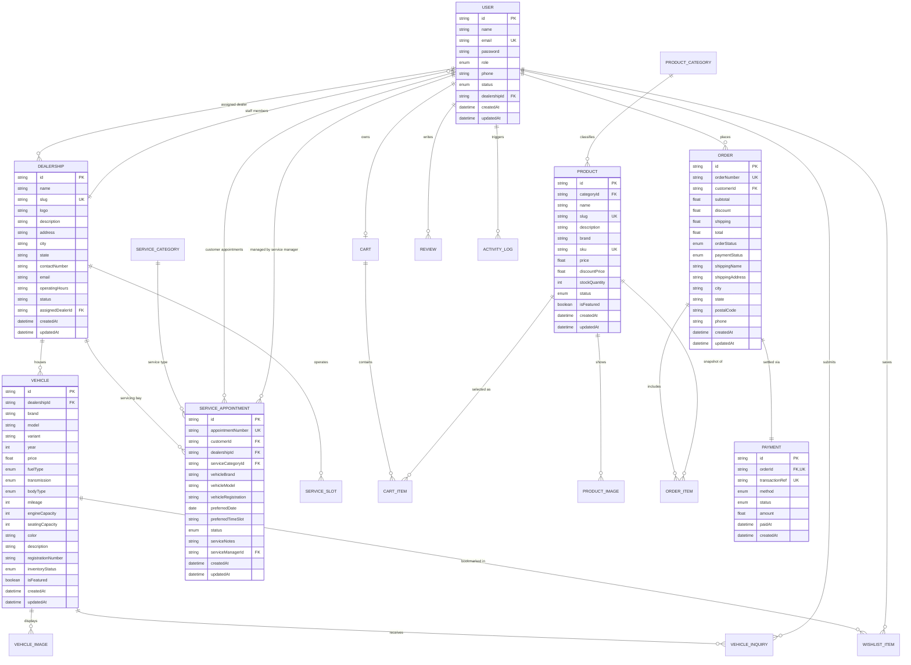

# CarCraft Database Design & Schema Documentation

## 1. Overview
The database for **CarCraft: Automotive Inventory & Dealership Suite** is modeled as a normalized relational schema on **PostgreSQL** managed through **Prisma ORM**. It enforces strict referential integrity, foreign key constraints, cascading deletes where appropriate, and indexed lookup fields for multi-role platform operations.

---

## 2. Entity-Relationship (ER) Diagram

---

## 3. Data Dictionary

### A. Core Platform Models
- `User`: Manages credentials, contact information, role (`ADMIN`, `DEALER`, `CUSTOMER`, `SERVICE_MANAGER`), account status (`ACTIVE`, `SUSPENDED`), and optional dealership association.
- `Dealership`: Multi-location dealership profile with city, state, operating hours, and foreign key reference to assigned dealer.
- `ActivityLog`: Immutable security log capturing actors, actions, affected entity IDs, metadata payloads, and timestamps.

### B. Vehicle Inventory Models
- `Vehicle`: Comprehensive technical and commercial attributes for vehicles including brand, model, variant, year, price, fuel type, transmission, body type, mileage, engine capacity, seating, color, registration number, and inventory status (`AVAILABLE`, `RESERVED`, `SOLD`, `MAINTENANCE`).
- `VehicleImage`: One-to-many image URLs per vehicle with primary cover flag.
- `VehicleInquiry`: Inbound test drive and purchase leads submitted by customers or guests with notes and status tracking.
- `WishlistItem`: Composite unique link (`[customerId, vehicleId]`) for saved user favorites.

### C. E-Commerce Models
- `ProductCategory`: Automotive categories (`Car Accessories`, `Interior`, `Exterior`, `Electronics`, `Cleaning`, `Safety`, `Spare Parts`, `Performance`).
- `Product`: Accessories and parts catalog with SKU, brand, price, discount price, stock quantity, and availability status.
- `Cart` & `CartItem`: Persistent server shopping cart for authenticated users.
- `Order` & `OrderItem`: Order records with line-item price freeze preserving historical unit price upon purchase.
- `Payment`: Transaction reference, payment method (`UPI`, `CARD`, `COD`), simulated gateway status, and timestamp.

### D. Service Scheduling Models
- `ServiceCategory`: Catalog of service packages with baseline pricing and standard duration minutes.
- `ServiceSlot`: Configurable bay capacity per weekday and time-slot at each dealership.
- `ServiceAppointment`: Booking entity capturing vehicle details, date, time slot, appointment reference number, workshop status, and service manager technician notes.
